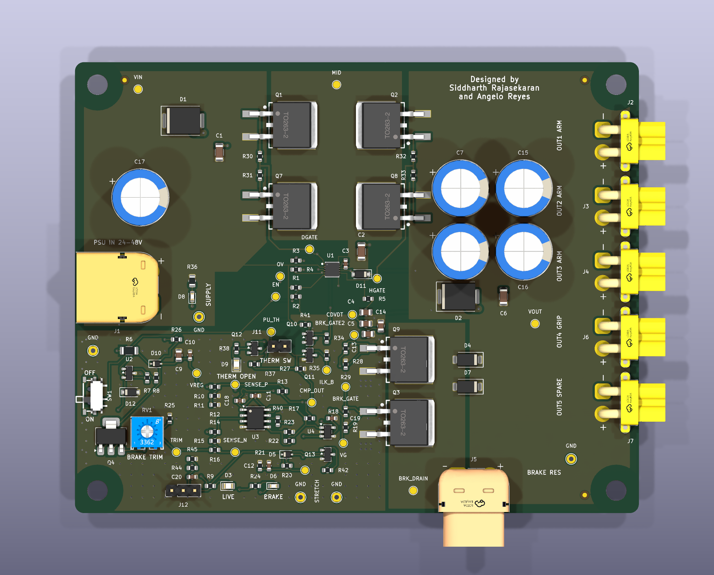
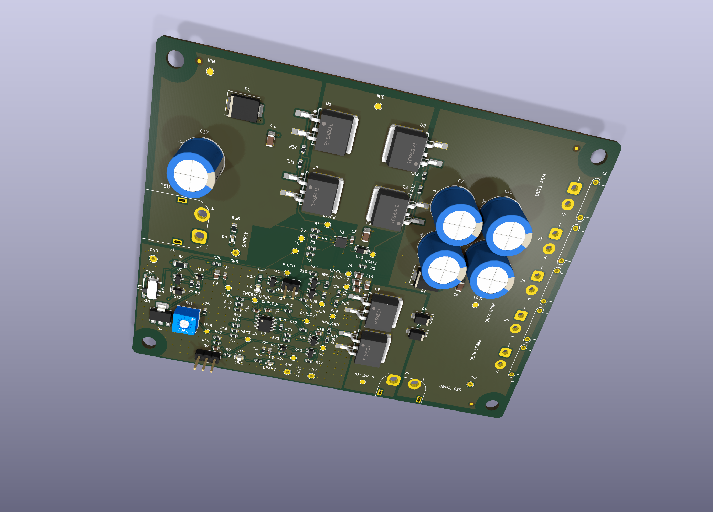
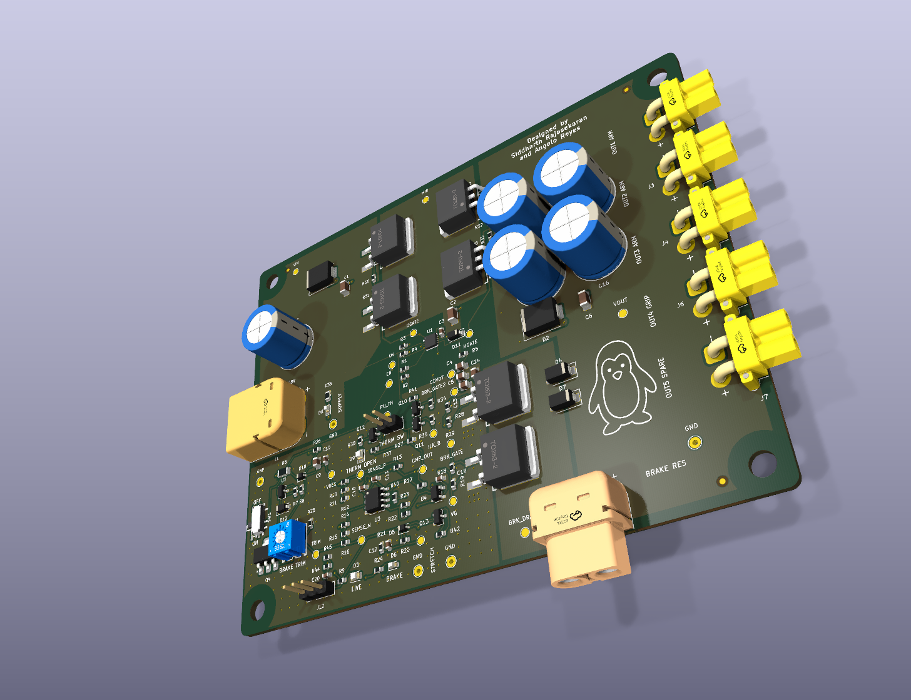
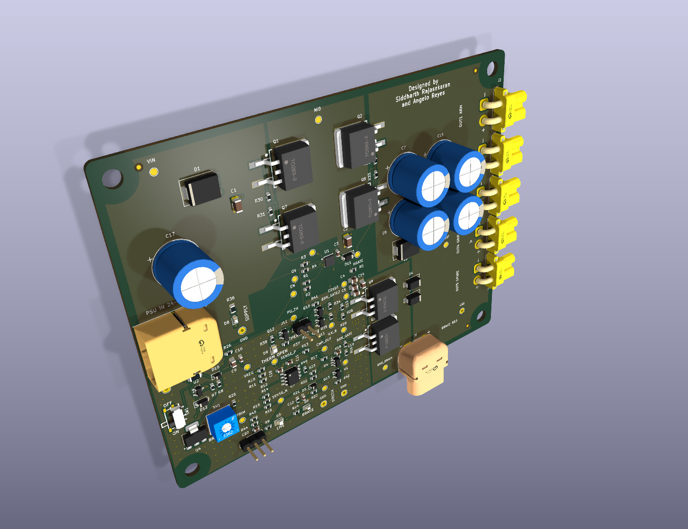
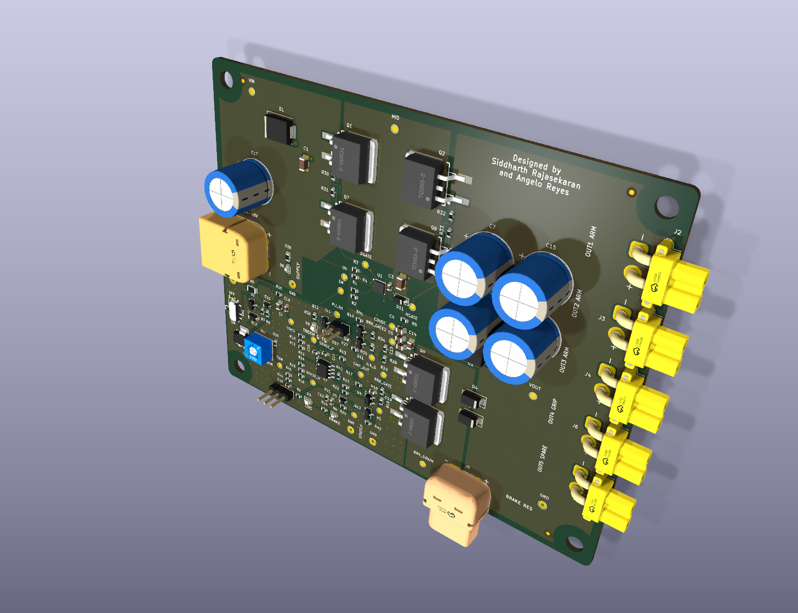
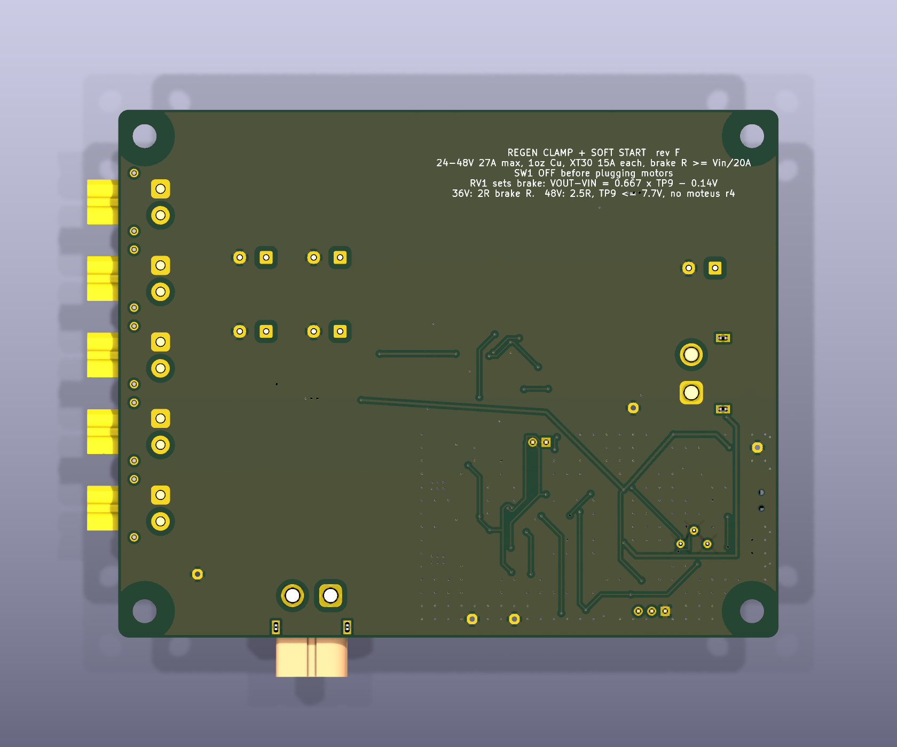

# Regen clamp + soft-start board (rev F)

**Quick links:** [JLCPCB Ordering & Settings](#ordering-and-cost) · [Manufacturing Files (`jlcpcb/`)](jlcpcb/) · [Schematic PDF](docs/regen_precharge_schematic.pdf) · [Factory Assembly View](docs/regen_precharge_revF_factory.png) · [Bring-up](#bring-up)

**Prototype for bench evaluation.** The board has not been built or measured. KiCad ERC and DRC pass on this copy,
and the control rail and braking figures below are design targets from calculation and simulation.

**Brake capacity.** The brake can absorb at most (supply + trip) ÷ R. With one 2 Ω resistor at 36 V and a +4 V trip
that is 20 A of current returned by the motors, net of what the other joints draw. Above that the bus keeps
rising: in simulation a 22 A, 15 ms return reaches 44.2 V, past the moteus r4's 44 V absolute maximum, and 27 A
reaches 53.8 V. Either limit the arm's deceleration and backdriving so the net returned current stays under
about 18 A at 36 V, or fit two resistors in parallel (see [Two brake resistors](#two-brake-resistors-in-parallel)).
Measure the returned current, resistor duty and connector fit before fast or backdriven operation. The
[engineering review](docs/arm-manufacturing-review.md) has the sweep, the assembly files checked and the
release gates.

A 125 × 100 mm two-layer board that sits between a bench supply and the arm.
The supply plugs into an XT60 in the middle of the left edge; five XT30
outputs sit along the right edge. Outputs 1–3 feed the arm's IM6014 motors, two or
three daisy-chained on each; output 4 feeds the gripper's moteus controller and
output 5 is a spare. It works from 24 V to 48 V supplies, with the brake threshold
set by RV1. A #8-32 mounting hole sits in each corner. It does two jobs:

1. **Regen clamp.** An ideal diode stops motor regeneration from flowing back
   into the supply. When braking pushes the motor bus a set amount above the
   supply, two MOSFETs dump the energy into an external brake resistor. A red
   LED stretches the brake indication by roughly 0.3 s under the simulated conditions.
2. **Soft start (precharge).** The output turns on at about 140 V/s, to reduce inrush when enabling a discharged output. It does not prevent
   sparks when connecting a load to an already charged output bus.

Design inspiration: the [ODrive Regen Clamp](https://docs.odriverobotics.com/v/latest/hardware/regen-clamp-datasheet.html)
(ideal diode plus a brake chopper whose threshold is relative to the input) and
the [mjbots mjpower-ss](https://github.com/mjbots/power_dist/tree/main/hw/mjpower-ss)
(a high-side FET ramped slowly to precharge the load, with an output on/off switch).

## Board renders

| Power input and brake connector | Motor outputs and brake connector |
| --- | --- |
|  |  |
| **Power-input side, opposite corner** | **Motor-output side, opposite corner** |
|  |  |

## Revisions

None of these has been ordered.

Rev F started as a cost-down of rev E. Later rev F edits adjusted the top-layer copper clearances described below.

- **Ordered in 1 oz copper instead of 2 oz.** JLC's live quote on 2026-11-11 for five 125 × 100 mm boards was
  $47.40 in 2 oz and $10.10 in 1 oz. A sheet-resistance and heat calculation from the board file
  (`review_tools/copper_check.py`, see Current handling) gives 3.1 mΩ and 2.2 W of copper heat at 27 A in 1 oz,
  against 1.5 mΩ and 1.1 W in 2 oz; the hottest spot, a MOSFET tab, is calculated at about 65 K above ambient in
  still air against 46 K. The layout still meets JLC's 2 oz rules, so the same Gerbers can be ordered in 2 oz
  if you want that margin back.
- **SW1 is hand-soldered**, which drops one extended-part fee ($3.07). The front stencil now omits its pads and the other hand-solder positions.
- **D12 is a BZT52C16** (C19077413, 15.2–16.8 V) instead of a BZT52C15, same SOD-123 footprint. JLC's catalogue data
  lists it as a Preferred part, with no loading fee on Economic assembly; JLC's part page only says Extended, so check the
  fee on the order page. The fault limit on the control rail rises from about 15 V to under 17 V, still below the
  20 V limits of U4 and the MOSFET gates.
- **Silkscreen:** connector outlines are trimmed 0.25 mm inside the board edge and the MOSFETs' small pin-1 dot is
  gone (Q9's sat on C13's pad; the heavy mark beside pin 1 stays). DRC now reports no warnings at any severity and
  the gate waives nothing. The project footprint library holds the same edits.
- **BUS_ADC** is the new name of the VBUS_ADC telemetry net. Konnect's design review took the old name for a power
  rail and asked for a 10 µF capacitor on it; it now reports no findings.
- The back legend reads rev F, 27 A max, 1 oz Cu, and has a line with the 36 V and 48 V settings.
- **From an independent review of the public rev E files (15 Nov 2026).** It found no netlist, pin, copper or
  fab-file error. Of its four layout points, two were already fixed here (SW1's direction, J5's slot pads) and two
  still held and are fixed now:
  - *Bus-voltage pads were 0.40 mm from ground copper*; IPC-2221B gives 0.5 mm for uncoated terminations at 51–100 V,
    which the bus reaches during braking on a 48 V supply. Every pad on a net that can pass 50 V is now at least
    0.5 mm from ground copper, and the hand-soldered bus pins of the XT connectors and electrolytics 1.0 mm.
    `review_tools/bus_clearance_check.py` shows 29 pads under 0.5 mm before and none after. Raising the whole top
    ground pour to 0.5 mm was tried first and rejected: it cut the ground of U4 and C19.
  - *The back legend ended 0.08 mm from the board edge*; it is moved 5 mm right. KiCad's DRC only reports
    silkscreen that crosses the edge, so `review_tools/silk_edge_check.py` now checks the margin.
  - *48 V margin*: the limit at 48 V is now +5 V (TP9 at most 7.7 V) instead of +6 V, as the review recommends (this also keeps `U3A`'s inputs below the `LM393` cold `VCC − 2.0 V` common-mode ceiling up to 55 V).
  - `tools/review_tools/check_bom.py` now checks capacitor voltage ratings, electrolytic can dimensions, and `>= 75 V` (`>= 150 V` on `R6, R36`) working-voltage ratings on bus-connected resistors against the catalogue.
  - *0.1 % sense resistors*, added 16 Nov because the board will also run on 48 V: R10 and R14 are now 100 k 0.1 %
    (Yageo RT0603BRD07100KL, C122538) and R11 and R15 20 k 0.1 % (RT0603BRD0720KL, C723637), same 0603 footprint,
    75 V rated. The review puts the trip spread at 48 V at about 0.6 V with them, against 3.5 V with 1 % parts, so the
    brake releases above the supply in every corner and the interlock is a backup. Both values remain on the
    machine BOM as Extended parts. The tolerance figures elsewhere in this file (±1.4 V at 36 V, ±1.8 V at 48 V) are the
    older 1 % numbers and are now pessimistic. `build-scripts/sense_resistors.py` is the record.
  `build-scripts/review_nov15.py` is the record of the board edits.
- **SW1 is labelled OFF and ON at the two ends of its travel**, in place of one "ON/OFF" caption. The MSK12C02
  drawing shows the knob at the pin-3 end joining pins 3 and 2, and at the pin-1 end joining 2 and 1. Pin 1 is ground
  and pin 2 is EN, so ON is the slider toward the bottom board edge. `tools/check_parts.py` now fails if the labels are swapped.
- **Connector polarity settled from the Amass drawings**, and checked by `tools/check_parts.py`: pad 2 of J1 and of
  J2–J4, J6, J7 is the contact at the flat end of the housing, which is the + contact (see Verification status).
- New simulations: `sim_post_layout.cir`, `sim_soft_start.cir`, and `tools/review_tools/full_board_spice_check.py` (see Verification status).
- **The six TO-263 MOSFETs (`Q1, Q2, Q3, Q7, Q8, Q9`) stay on JLCPCB's SMT reflow line**, while the 1206 capacitors
  (`C1, C2, C6`) remain hand-soldered (reflow them with hot air or a hot plate rather than a point iron,
  to avoid ceramic thermal-shock cracks). The MOSFETs retain the corrected 3D model offset and front stencil paste openings.
- **R6, the SMC and SMA diodes (D1, D2, D4, D7), the two SOD-123 Zeners (D11, D12) and the SOT-223 transistor
  (Q4) stay machine-placed.** An earlier commit on this branch moved them to hand soldering; only D11 carried a fee,
  so the other seven added hand work for no saving, and the owner asked for them to go back on the machine.
  The schematic's assembly field and the PCB placement exclusions drive the exports.
- **From a follow-up review (17–18 Nov 2026):** `J1` and `J5` contact holes are centred in Amass's `2.90 +0.10/-0.00 mm`
  and `0.80 +0.10/-0.00 × 1.90 +0.10/-0.00 mm` windows at **3.0 mm** with **0.9 × 2.0 mm** fixing slots (`1.5 × 2.6 mm`
  pads, keeping the `0.30 mm` plated ring) so JLCPCB's `-0.08 mm` plating tolerance cannot finish undersize; thermal relief
  spokes now protect the five 470 µF bulk capacitors (`C7, C8, C15, C16, C17`), `J12` pin 1, the hand-soldered SMDs
  (`C1, C2, C6, SW1`), and 58 small `0603`/`0805`/`SOD` passives (preventing reflow tombstoning and `SW1` housing heat
  damage while keeping MOSFET, power-diode, and XT connector pads solid); `C8`'s silkscreen label moved clear of `D2`'s
  body; `tools/sch_layout.py` is bundled in `tools/`; `B.Paste` is included in the 11-file Gerber archive; and the schematic
  title block and notes are updated to rev F, 27 A, four output bulk capacitors and D12 under 17 V (`tools/rev_f_review_fixes.py`).
- The PCB and schematic both use the bundled 1 mm fiducial footprint so that a change in the installed KiCad library does not affect the release checks.
- `build-scripts/cost_down.py` and `tools/rev_f_review_fixes.py` are the record of these edits.

Rev E, changes from rev D. Most of these were found by independent reviews:

- **U2 CJ431 pins corrected.** The board used TL431 numbering, but this part's SOT-23
  is pin 1 REF, pin 2 K, pin 3 A. The control rail could not have worked.
- **RV1 ends swapped**, so clockwise raises the brake threshold.
- **J1 and J5 holes enlarged** to 2.9 mm with 0.8 × 1.9 mm fixing slots, per the
  XT60PW-M30 drawing served for C98732. The old 2.7 mm holes and 0.6 × 1.7 mm slots
  could not take the connector. The XT60PW-F PDF gives no PCB holes, so J5 uses the
  same sizes.
- **C13 moved out from under Q9, and R30–R33 moved clear of the MOSFET plastic.**
  C13 sat under Q9's body and gate lead, which would have stopped assembly. A DRC
  warning showed it, and it had been wrongly waived as cosmetic.
- **Ideas from a friend's board:** a UCC27517 gate driver (U4) replaces the Q5/Q6 transistor pair, so
  the brake switches in tens of nanoseconds and the LM393 no longer sinks a transistor's base current;
  the five 470 µF capacitors (four on the output, one on the input) are now 100 V (12.5 × 30 mm, same footprint, 5 mm taller); and J12 gives a
  microcontroller GND, BUS_ADC (VOUT × 0.053, 3.3 V at 62 V) and BRK_FLAG (open drain, low while braking).
- **Q4 is now a BCP56-16 in SOT-223** (94 °C/W, 1.33 W) instead of an MMBT5551 in SOT-23 (416 °C/W).
  Braking adds rail load, and the old part could pass 150 °C at moderate ambient. It sits at the lower left.
- **J5's fixing pads give a 0.3 mm plated ring** on every side, for JLC's 2 oz rule; J5 moved 0.4 mm inboard.
- **Copper kept out of an 11.5 mm circle round each corner hole**, both layers, so a
  metal screw head or washer can't short VIN or VOUT to a grounded standoff.
- **D10 (1N4148WS) added across Q4's base and emitter.** When VOUT collapses while C9
  still holds the rail up, the junction no longer breaks down in reverse.
- **D11 (BZT52C12, 12 V) clamps HGATE to VOUT.** The 400 nF soft-start capacitor holds
  HGATE up when VOUT falls, and with no clamp HGATE minus OUT could pass U1's 15 V
  absolute maximum and the MOSFETs' 20 V gate limit: 18 V or more after long regen, far
  more on a supply removal or output short. R5 limits the peak clamp current to ~47–60 mA (`< 0.3 mJ`).
  Scope HGATE minus OUT at bring-up.
- **D12 (BZT52C15) clamps Q4's base.** If U2 or R7 opens, R6 would pull the rail up to the bus,
  past the LM393's 36 V and the brake MOSFETs' 20 V gate limit. Now the rail stays under about 15 V.
- **Five XT30 outputs instead of three**, so the arm's seven motors split two or three per
  output, all within the XT30's 15 A rating.
- **C3 raised to 470 nF**, from TI's VCAP ≥ 10 × (Ciss Q1 + Ciss Q2) with four MOSFETs.
- **C17 (470 µF 100 V) added on VIN.** Only 1 µF sat there, so turning Q2/Q8 off under load
  could spike VIN past U1's 70 V through the supply lead's inductance. Connect the supply with it off.
- **J2–J5 moved out** so each connector's nose hangs off the board edge. The mating plug's
  shell wraps the nose and could have hit the PCB and stopped short of full mating.
- **D1 and D2 ground returns strengthened** from one via to three.
- **U1's exposed pad paste reduced to about 82 %** (0.08 mm smaller each side), per TI's stencil example.
- **From the final three-model review:** R40 (100 k) limits current into U3 pin 6 if the rail drops
  while C12 is charged; R41 (10 k) in Q10's base limits a reversed-supply fault path through Q10/Q11;
  C18 (1 nF) filters noise from the J11 wiring on CMP_OUT; C19 (1 µF) is a local supply for the
  brake gate driver (Q5/Q6 then, U4 now); C3 is now 1 µF so it stays above TI's 271 nF after DC-bias loss; C13 moved
  0.4 mm further from Q9's gate pad; connector fixing pads enlarged for 2 oz plating; the screw
  keep-out widened so no copper sits within 5.5 mm of a hole centre.

Rev D, changes from rev C:

- XT60 input centred on the left edge and the three XT30 outputs centred on the
  right edge, so the four corners are free for #8-32 holes (4.5 mm, 5 mm in from
  each edge).
- Two debug LEDs: D8 (white, SUPPLY) shows the PSU is connected even with SW1
  off; D9 (yellow, THERM OPEN) shows, while the output bus is up, that the J11
  thermal loop is open, which is the usual reason the brake never fires.
- Eight more test points (TP18–TP25): OV, CDVDT, interlock, second brake gate,
  thermal loop, driver output, and two more GND holes by the input and outputs.
- The VIN pour now fills the area beside U1, which keeps input current density
  down with the XT60 in its new place.
- Design rules raised to JLCPCB's 2-layer 2 oz limits, 0.16 mm track and
  clearance (earlier revisions used 1 oz limits, 0.127/0.15 mm, and 51 tracks
  were too thin for 2 oz). The 2 oz stackup is now recorded in the board file.
- Three fiducials added, and the router's dead-end stubs removed.

Rev C, changes from rev B:

- XT60 input instead of XT90, and 3 outputs instead of 7.
- Brake interlock (Q10, Q11): the brake is intended to be held off while the ideal diode
  conducts. The behavioral latch test covers one tolerance corner; it does not
  prove that every transient and component fault avoids supply-fed braking. In rev B, worst-case
  1 % resistor tolerances at the lowest trim setting could put the brake's
  release point below the supply at 36–48 V, and the brake would then latch on
  and pass about 24 A from the PSU into the resistor.
- One 10 Ω gate resistor per paralleled MOSFET (R30–R33), to stop parasitic
  oscillation while the soft-start pair runs in its linear region.
- Gate drive nets run on the top layer between the power pours, so no gate
  traces cut the bottom ground plane.
- R26 470 Ω (was 1 kΩ): the intended emitter follower has more collector headroom. The
  earlier claim of a guaranteed 11.3 V rail at 15 V is withdrawn; CJ431 bias
  current and the exact U2 pinout must be corrected.
- TVS diodes D1/D2 use JLC's Preferred SMCJ51A (C42371549): same part, no
  extended-part fee.

## Ratings

These are board design targets. Each attached controller must tolerate the maximum
bus voltage, including regen and transients. Unitree's public N6014B-12.6 page
lists 24–75 V input, so 15 V is outside that motor's published range. Moteus
limits depend on the exact model: r4 is 44 V absolute maximum, c1 is 51 V,
and n1/x1 are 54 V. A generic "moteus" output is not validated for 48 V plus regen.
See the manufacturer [Unitree specification](https://www.unitree.com/IM6014/)
and [moteus electrical limits](https://mjbots.github.io/moteus/reference/hardware/).

| Item | Value |
|---|---|
| Supply | 24–48 V DC, any voltage in that range without changing parts; set the brake threshold with RV1 for each supply. UVLO on at ≈13.5 V; input over-voltage cut-off ≈57 V. **A moteus r4 (44 V absolute maximum) needs a supply of 36 V or less and RV1 set for a trip of +5 V or less**: 36 V + 5 V + 1.4 V tolerance = 42.4 V |
| Current | Sized for the 27 A supply. At 27 A continuous on 1 oz copper the calculated rise in still air is about 65 K at the hottest MOSFET tab and 28 K averaged over the board, with worst-case hot MOSFET resistance; this is a calculation, not a measurement. The arm's average current is far below 27 A. Peaks to 60 A are within the MOSFET ratings but not thermally validated. **Order with 1 oz copper**; 2 oz lowers the hot spot to about 46 K for about $37 more on five boards. Minimum track and clearance 0.16 mm |
| Outputs | 5 × XT30PW-F. Each is rated 15 A continuous (30 A burst), so keep each daisy chain within that; the 27 A supply limits the total |
| Input | XT60PW-M (30 A continuous) |
| Mounting | 4 × #8-32, corners, 115 × 90 mm hole spacing. No copper within 5.5 mm of each hole centre on either layer, so the screw head or washer must be under 11 mm across |
| Ambient | U3 is rated 0–70 °C. Q4 (SOT-223, 94 °C/W) runs about 20 °C above ambient at 48 V idle and about 30 °C during braking |
| Brake threshold | Set with RV1: brake turns on at 3.0 to 7.5 V above the supply and off about 2.3 V lower |
| Brake | Two paralleled MOSFETs into one external resistor on an XT60, or two resistors in parallel. Peak brake current = (supply + trip) ÷ R; keep it at or below 25 A per resistor and fuse |
| Brake resistor | Pick by supply so the brake can absorb the arm's regen: it sinks at most (supply + trip) ÷ R, which must stay under 25 A. 1.5 Ω at 24 V (19 A at +5 V), 2 Ω at 36 V (20.5 A at +5 V), 2.5 Ω at 48 V (22 A at +7.5 V); all 200 W. A larger resistor brakes less: 2.5 Ω at 36 V sinks only 16 A, and regen above that keeps climbing. For more than about 20 A at 36 V, fit [two resistors in parallel](#two-brake-resistors-in-parallel) |
| Resistor over-temperature | J11: a normally-closed thermal switch on the resistor disables the brake when it opens. Fit a jumper if unused. |
| Last-resort protection | One Q136 thermal fuse clamped to the resistor, wired in one resistor lead (see Brake resistor wiring). Required: a shorted brake MOSFET can't be stopped any other way |
| Soft start | 0.26 s from 0 to 36 V; ≈0.26 A into the 1880 µF on the output (C7, C8, C15, C16; C17 is on the supply side of the switch and charges straight from the supply), plus about 0.14 A per extra 1000 µF the arm adds (≈0.55 A into 4000 µF: 0.355–0.833 A including HGATE current and ±10 % capacitor tolerance, before DC bias) |
| Backstop | SMCJ51A TVS on input and output. These catch short transients only; they are not a backup for the brake |

Settings for the two supplies this board is meant for:

| | 36 V supply | 48 V supply |
|---|---|---|
| Brake resistor | 2 Ω 200 W | 2.5 Ω 200 W |
| RV1 (TP9) | up to 11.45 V (+7.5 V); 7.7 V or less (+5 V) with the moteus r4 | 7.7 V or less (+5 V) |
| Simulated bus peak at that setting | 43.7 V at +7.5 V; 40.2 V at +4 V | 53.2 V at +5 V; 52.2 V at +4 V |
| Simulated brake current, peak | 21.5 A | 21.0 A |
| Gripper on a moteus r4 | yes, trip +5 V or less | no: 44 V absolute maximum |
| Margin | 100 V MOSFETs and capacitors; U1 65 V operating | the reviewer's worst case at +5 V, with every tolerance stacked, is 54.8 V, under the TVS's 56.7 V minimum breakdown and U1's 65 V |

At 48 V keep the trip at +5 V or below (TP9 at most 7.7 V). An independent review stacked every tolerance (1 %
resistors, comparator offset, rail and trimmer) and found the bus could reach 57.6 V at full trim, past the SMCJ51A's
56.7 V minimum breakdown; a TVS that conducts before the brake trips would carry the regen current alone and fail.
At +5 V the same stack gives 54.8 V. The supply itself must stay under the 57 V input cut-off, so a 48 V supply
trimmed above about 52 V is too high. These figures are calculated and simulated, not measured.

The board passes current, it doesn't make it: running 30 A needs a supply that
can deliver 30 A. The 27 A bench supply limits the current it supplies. Motors can collectively return more current than the brake can absorb during deceleration or backdriving.

## Setting the brake threshold

The brake compares the motor bus (VOUT) with the supply (VIN), so it follows the
supply automatically. RV1 sets how far above the supply it trips:

    trip voltage above supply ≈ 0.667 × V(TP9 TRIM) − 0.14 V
    release voltage           ≈ trip − 2.3 V

Measure TP9 to a GND test point and turn RV1: clockwise raises the threshold. 6.2 V at TP9 gives a +4.0 V trip
and +1.8 V release (U4 drives the gates to the full 11.6 V rail, which widened the hysteresis from 2.0 V). The range is 4.7–11.6 V at TP9, giving a +3.0 to +7.5 V trip.

These are nominal values. With 1 % resistors the actual trip can be up to about
±0.7 V off at 15 V and ±1.8 V off at 48 V, so measure the actual switching thresholds during corrected-revision bring-up.
The behavioral interlock model prevents supply-fed latching at the tested corner.
Its real DGATE loading, linear regulation, startup and supply-off behavior remain
unverified. A low trim setting is not a general safety guarantee.

## Connections

| Ref | Connector | Where | Use |
|---|---|---|---|
| J1 | XT60PW-M | Left edge, centre | From the PSU (pad 2 is +: the contact at the flat end of the housing, where the + is moulded; pad 1 is −), through a 30 A fuse rated for at least 60 V DC (common MIDI and MAXI automotive fuses are only 32 V) |
| J2 | XT30PW-F | Right edge, 1st from top | Output 1: arm motors, 2–3 daisy-chained (pin 2 +, pin 1 −; check with a meter before connecting anything, see Bring-up) |
| J3 | XT30PW-F | Right edge, 2nd | Output 2: arm motors |
| J4 | XT30PW-F | Right edge, 3rd | Output 3: arm motors |
| J6 | XT30PW-F | Right edge, 4th | Output 4: gripper moteus controller (see the r4 limit under Ratings) |
| J7 | XT30PW-F | Right edge, 5th | Output 5: spare |
| J5 | XT60PW-F | Bottom edge | Brake resistor (either way round) |
| J11 | 2-pin header | Middle | Normally-closed thermal switch (e.g. KSD9700, 70–90 °C) on the brake resistor, or a jumper. Twist its two wires together and keep them away from the brake resistor leads |
| J12 | 3-pin header | Bottom left | For a microcontroller: pin 1 GND, pin 2 BUS_ADC (VOUT × 0.053 through 100 k / 5.6 k, filtered by 100 nF), pin 3 BRK_FLAG (2N7002 open drain, low while braking; pull it up on the microcontroller side). BUS_ADC passes 3.3 V only if VOUT goes above 62 V, which happens only in a fault: at the TVS's 82 V clamp it would be 4.4 V from a 5.3 kΩ source, about 0.15 mA into the microcontroller's clamp diode. Check the microcontroller's injection-current limit |
| SW1 | slide switch | Left edge | Output on/off. ON is the slider toward the bottom board edge, as labelled. Plug or unplug loads only with SW1 off. The slider faces off the left board edge, with its tip about 0.3 mm inside the edge, so you can slide it with a fingertip from the side. |
| RV1 | 3362P trimmer | Bottom left | Brake threshold |

## Two supplies: use two boards

For more than one supply's current, use one board per supply, not two supplies on one board.
Each board carries one supply's current (27 A, what rev F is sized for) and clamps its own regen.

- Give each board its own supply, brake resistor and thermal fuse.
- Split the motors between them, for example arm motors 1–4 on board A, and motors 5–7 plus
  the gripper on board B. Keep each XT30 chain within 15 A.
- Join only the grounds, so the motors' signal wiring has a common reference. **Never join the two
  output buses or the two supplies' positive leads**: one board's brake would then also be
  clamping the other supply.
- Set RV1 the same on both boards for the same supply voltage.

Measure the arm's current on one 27 A supply first. Short peaks are absorbed by the bulk
capacitors and the supply's current limit, so one board may be enough.

## Brake resistor wiring

    J5 pin 2 (VOUT) ── Q136 thermal fuse ── brake resistor ── J5 pin 1 (BRK_DRAIN)

J11 turns the brake off by removing gate drive, so it can't help if a brake
MOSFET has failed short. With the chosen 2 Ω resistor on the 36 V supply it then sits across the bus:
18 A and 648 W, far above its 200 W rating (1.5 Ω at 24 V: 16 A and 384 W; 2.5 Ω at 48 V: 19.2 A and 922 W).
Normal braking at 36 V + 5 V peaks at 20.5 A and about 840 W; at 48 V + 7.5 V with 2.5 Ω, 22 A and about 1.2 kW. Neither the 30 A supply fuse nor a 27 A supply
limit stops that. A correctly selected and installed thermal fuse can open that resistor branch.
Its DC rating does not prove that it opens before the resistor or wiring fails,
or protect against a short that bypasses the fuse.

**Part:** SETfuse Q136, LCSC C22396303. One-shot alloy fuse, opens at 136 °C
(131 ± 2 °C fusing), 25 A, listed for DC 120 V (TÜV-certified for DC per the
datasheet). Hold temperature 102 °C, maximum 200 °C. Buy spares: each one that
opens must be replaced.

**Why this one:** the manufacturer explicitly lists Q136 for 25 A at 120 V DC.
An AC-only rating would not establish DC interruption capability. Peak current
must stay within the selected fuse and resistor limits at the actual bus voltage. The hold temperature sits
above the 70–90 °C J11 switch, so an ordinary overheat trips J11 first and the
fuse is left intact.

**Fitting it:**

- Put it on the resistor body, not on this board: it has to feel the resistor's
  temperature. Clamp it flat against the case with thermal paste. Don't load the
  leads; the datasheet warns against pulling or twisting them.
- Join the leads with crimps, which the datasheet allows, using low-resistance
  connections and wire sized for 25 A. A poor joint heats up and opens the fuse
  early. If you solder, stay within the datasheet's limits: for example 3 s with
  at least 10 mm of lead, using a heat sink.
- Its leads carry bus voltage, so insulate them and keep them off the case.
- Keep it away from heavy vibration, so mount the resistor on the bench, not the arm.

**Limits, so you don't over-trust it:**

- It is slow. The datasheet's oil-bath curve shows about 35 s at 140 °C and 15 s
  at 150 °C, and the resistor's case has to heat up first. My rough estimate is
  20 s or more to bring a 150 g aluminium case up 100 K at 648 W, so expect the
  resistor to be badly overloaded for up to a minute or so. It may fail open first.
  This has not been measured. Keep the resistor on a non-flammable surface.
- Before relying on it, measure the case temperature with a thermocouple during
  your hardest braking. It must stay below 102 °C. Check the J11 switch opens
  first.
- If it opens, the brake is gone and the next regen event will overvolt the bus.
  Stop, find out why, and test Q3/Q9 before fitting a new one (see below).

## Two brake resistors in parallel

One 2 Ω resistor at 36 V absorbs at most about 20 A of returned current. If the arm can return more, fit two
identical resistors in parallel on J5: two 2 Ω at 36 V (1 Ω), or two 2.5 Ω at 48 V (1.25 Ω). The board needs no
change. Each resistor gets its own thermal fuse and its own thermal switch:

    J5 pin 2 (VOUT) ──┬── Q136 fuse A ── resistor A ──┬── J5 pin 1 (BRK_DRAIN)
                      └── Q136 fuse B ── resistor B ──┘

    J11: thermal switch A ── thermal switch B   (in series, so either one turns the brake off)

Simulated in `sim_post_layout.cir` (36 V, +4 V trip, 1 µH per resistor's leads / 0.5 µH combined, 15 ms pulses):

| Returned current | One 2 Ω: bus peak | Two 2 Ω: bus peak | Two 2 Ω: brake peak / RMS |
|---:|---:|---:|---:|
| 15 A | 40.2 V | 40.2 V | 39 A / 24 A |
| 22 A | 44.2 V | 40.3 V | 39 A / 29 A |
| 27 A | 53.8 V | 40.4 V | 39 A / 32 A |
| 35 A | — | 40.5 V | 39 A / 37 A |

The brake MOSFETs peak at 45.8 V at 36 V and 59.1 V at 48 V, the same as with one resistor, with no avalanche.
They are rated 120 A. Each fuse carries about 20 A, inside its 25 A rating. At 48 V the bus still peaks at
53.4 V, so the gripper rule doesn't change: no moteus r4 at 48 V.

What it costs:

- A second resistor, fuse and thermal switch. The pair can take 400 W on average, twice as much as one.
- J5 (XT60, 30 A continuous) carries 24–37 A RMS while braking hard. Short braking events are fine; it is not
  rated for continuous braking at that level, and the resistors aren't either.
- The four output capacitors carry about twice the ripple, roughly 3.5 A RMS per capacitor while the brake
  chops, against an estimated rating of about 1.3 A at ~1 kHz (frequency-derated from the 1.69 A figure at 100 kHz).
  Short stops are fine; a long slow loaded descent heats them. Measure the capacitor cases during your longest descent
  and keep them under 85 °C.
- If one fuse opens, the brake falls back to one resistor's 20 A. Check both fuses with a meter after any
  overheat.

## LEDs

| LED | Colour | Label | On means |
|---|---|---|---|
| D8 | White | SUPPLY | The PSU is connected. Independent of SW1; dim at 24 V, bright at 48 V |
| D3 | Green | LIVE | The control rail is up, which means the output bus has voltage on it: SW1 is on (it lights during the ramp, not only at the end), or the arm is back-driving the bus |
| D6 | Red | BRAKE | The brake fired in the last 0.3 s |
| D9 | Yellow | THERM OPEN | The J11 loop is open (no jumper, or the resistor's thermal switch has tripped), so the brake is disabled. It shares the control rail with the green LED; visibility is not a rail-voltage guarantee |

## Test points

Bare 1.5 mm pads labelled with their signal on the silkscreen. The GND points
(TP15–TP17, TP24, TP25) are 2 mm plated holes for a scope clip or wire loop: TP25
sits by the input, TP24 by the outputs, the others in the control area.

| TP | Net | What to expect |
|---|---|---|
| TP1 | VIN | Supply voltage |
| TP2 | MID | ≈ VIN when running (drains of Q1/Q7 and Q2/Q8) |
| TP3 | VOUT | ≈ VIN when enabled; nominal ramp ≈0.26 s to 36 V or ≈0.35 s to 48 V |
| TP4 | BRK_DRAIN | ≈ VOUT when idle; drops to ≈0 V while braking |
| TP5 | VREG | Intended ≈11.6 V at adequate supply; low-voltage rail unvalidated |
| TP6 | DGATE | VIN + about 10–13 V at full drive; lower below about 5 A, because U1 regulates 10.5 mV across the MOSFETs; near VIN when off |
| TP7 | HGATE | Ramps toward VOUT + 11 V during soft start; measure HGATE − VOUT to check turn-off, not HGATE to ground. Equals VOUT with SW1 off and a charged bus |
| TP8 | EN | ≈ 0.09 × VIN when on; 0 V with SW1 off |
| TP9 | TRIM | 4.7–11.6 V; sets the brake threshold |
| TP10 | SENSE_P | ≈ 0.15 × VOUT (comparator + input) |
| TP11 | SENSE_N | ≈ 0.15 × VIN plus the trim offset (comparator − input) |
| TP12 | CMP_OUT | 0 V idle, ≈ VREG while braking; stays near 0 V if the ideal diode is conducting, and at most about 0.75 V if J11 is open |
| TP13 | BRK_GATE | Gate of Q3: 0 V idle, ≈ 11.6 V pulses while braking |
| TP14 | STRETCH | Above 2 V while the red LED is lit |
| TP15–17 | GND | Ground |
| TP18 | OV | With SW1 on, ≈ 0.021 × VIN; SW1 off disconnects this ladder. Rising threshold ≈1.23 V |
| TP19 | CDVDT | Soft-start capacitor: ramps with HGATE at switch-on, then sits near VOUT + 11 V |
| TP20 | ILK_B | Interlock: ≈ 0.6 V while the ideal diode conducts (brake held off); 0 V while it blocks regen |
| TP21 | BRK_GATE2 | Gate of Q9: same as TP13 |
| TP22 | PU_TH | Thermal-loop supply side: equals TP12 with J11 closed; ≈ 7 V with J11 open |
| TP23 | VG | U4 output before R18/R28: 0 V idle, ≈ 11.6 V (the rail) while braking |
| TP24, TP25 | GND | Ground by the outputs and by the input |

## When something goes wrong

| Symptom | Check |
|---|---|
| No LEDs at all | PSU, fuse and J1 polarity; TP1 should read the supply |
| White on, green stays off | SW1 on? TP8 above 1.23 V (else UVLO or SW1)? TP18 below 1.23 V (else input over-voltage)? Then TP7/TP19 should ramp |
| Green on, output voltage low or ramping slowly | Soft start into a heavy load: look at TP7 and TP3 together; unplug loads and retry |
| Red stays on with nothing moving | TP10 is above TP11: turn RV1 up (raise TP9) |
| Brake never fires | Yellow lit means J11 is open. Otherwise watch TP12 and TP20 during regen: TP20 must drop to 0 V when the bus rises above the supply |
| Brake fires but the bus still climbs | Brake resistor too large or open, or the thermal fuse has opened (TP4 ≈ 0 V or floating; check the fuse with a meter, power off). TP4 should drop to ≈0 V during braking; check TP13 and TP21 both pulse |
| Resistor hot with no braking, TP4 stuck near 0 V, TP13 at 0 V | A brake MOSFET has failed short: turn the supply off at once. Replace Q3/Q9 before fitting a new thermal fuse |

## Current handling

- Power flows on top-layer pours; the bottom layer is mostly ground plane. It also carries about 380 mm of thin
  signal track, measured from the board file: the VOUT feed to the control rail (115 mm), VREG (58 mm), a VIN sense
  feed (49 mm), VG (31 mm), CMP_OUT (24 mm), PU_TH (21 mm), LEDR_K (20 mm), the DGATE tap (13 mm), OV (12 mm) and
  about 40 mm of short links. None of them blocks the output or brake return paths; the gate nets to the six
  MOSFETs stay on the top layer.
- Bus-voltage pads are at least 0.5 mm from ground copper (IPC-2221B, uncoated terminations, 51–100 V). Tracks
  under solder mask are held only to the 0.2 mm board rule: the closest is a CDVDT track 0.195 mm from C13's
  ground pad, and CDVDT reaches about 59 V at 48 V. IPC-2221B allows 0.13 mm for coated conductors at that
  voltage, and CDVDT sits behind 1 kΩ, so leakage there would only slow the soft start. Keep the board clean and dry.
- Copper resistance, heat and current density from `review_tools/copper_check.py`: every pour, pad and track of
  each power net is rasterised from the board file on a 0.2 mm grid (both layers, joined at plated holes and vias)
  and solved as a resistive sheet. 1 oz copper at 60 °C, 27 A through the board with the two farthest outputs
  loaded, and a 20 A brake pulse:

  | Path | mΩ | Heat at 27 A | Peak A per mm of width |
  |---|---|---|---|
  | VIN (XT60 → Q1/Q7) | 0.64 | 0.47 W | 3.9 |
  | MID (between the MOSFET pairs) | 0.16 | 0.12 W | 1.7 |
  | VOUT (Q2/Q8 → outputs 4 and 5) | 1.15 | 0.84 W | 4.0 |
  | Ground return, both layers (outputs → XT60) | 1.18 | 0.86 W | 3.8 |
  | Brake: VOUT (outputs → brake XT60), 20 A | 0.70 | pulses only | 2.9 |
  | Brake drain (XT60 → Q3/Q9), 20 A | 0.41 | pulses only | 4.7 |
  | Brake ground (Q3/Q9 → outputs), 20 A | 0.69 | pulses only | 2.3 |

  The through path totals 3.13 mΩ and 2.28 W. The peaks are at the pad necks and are 4 A/mm in either copper
  weight; in 1 oz that is about 110 A/mm² over a millimetre or two.
- The same script then spreads that heat, plus 4.9 W for the four series MOSFETs (13.5 A each at 6.7 mΩ, the
  4.2 mΩ maximum × 1.6 for a hot die), through the board: copper where each layer has it, FR-4 elsewhere,
  10 W/m²K off each face. Result at 27 A continuous: hottest point 66 K above ambient (Q1's tab), board average
  29 K. Until the tabs have been measured, treat 20 A continuous (about 36 K) as the working limit. In 2 oz: 46 K and 24 K. Heating goes with current squared: about 36 K at the hot spot at 20 A, 80 K at 30 A.
- This is a first-order calculation. It leaves out airflow, the connectors and capacitors as heat sinks, contact
  resistance and wiring, and it has not been compared with a measurement. Measure the MOSFET tabs with a
  thermocouple or thermal camera the first time the arm runs hard.
- Two MOSFETs share each power position (Q1‖Q7 ideal diode, Q2‖Q8 soft start,
  Q3‖Q9 brake). The electrical model predicts about 49–51 % sharing with equal
  4.2 mΩ channel resistance. Real part and temperature variation are excluded.
  Equal sharing is especially unproven during linear soft start. At 15 A per
  MOSFET, 4.2 mΩ gives 0.95 W at the specified cold gate drive; hot losses rise.
- Each brake MOSFET's source has six vias (0.8 mm pad, 0.4 mm drill) into the ground plane.
  Connector and MOSFET pads connect solidly, with no thermal spokes, so the XT connectors need a hot iron; the
  five 470 µF bulk capacitors and J12 pin 1 use 1.0 mm thermal spokes for easier hand soldering, and the three
  1206 100 V MLCCs (C1, C2, C6) should be soldered with hot air or a hot plate to avoid flex-cracking.

## How it works

- **U1 LM74800-Q1** drives two back-to-back pairs of N-MOSFETs (common drain).
  Q1‖Q7 are the ideal diode. TI specifies about 0.5 µs typical turn-off for a
  defined 10 nF gate load; that timing is not verified for this parallel pair. Q2‖Q8 are the soft-start switch: C4, C5, C13, C14
  (400 nF) on HGATE through R5 set the ramp. Each MOSFET has its own 10 Ω gate
  resistor (R30–R33). R1/R2 set UVLO; R3/R4 set the input over-voltage
  cut-off. SW1 pulls EN low to turn the output off.
- **Control rail.** CJ431 (U2) + BCP56-16 (Q4) make ≈11.6 V from the output bus, so the
  clamp keeps working when the supply is unplugged and the arm is back-driven.
  CJ431 needs up to 1 mA to regulate, which R6 can only supply above about 26 V.
  Below that, R6, R7 and R8 set Q4's base instead: about 10.9–11.3 V on the rail at
  15 V by hand calculation with 1 % resistors and full rail load. The trim voltage
  scales with the rail, so that moves the threshold by a few percent. Measure it.
  D10 protects Q4's base and emitter when VOUT falls faster than the rail.
- **Brake comparator (U3A, LM393).** Compares VOUT (R10/R11/R12) with VIN plus
  an offset from RV1 through R16 (R14/R15/R16). The two dividers are balanced,
  so the threshold does not depend on the supply voltage. R13 adds 2 V of
  hysteresis (about 2.3 V now that VG swings to the full rail). U4 (UCC27517) drives both brake MOSFETs through R18 and R28; D4/D7 clamp
  the resistor's inductive kick. The comparator's pull-up runs through J11, and
  R27 holds the brake off when the thermal switch opens.
- **Brake interlock (Q10, Q11).** DGATE can sit about 11 V above VIN at full gate drive.
  LM74800 also regulates its gate linearly to hold about 10.5 mV forward drop.
  DGATE is not a digital current-direction output. Q10
  (MMBT5401) turns that into base current for Q11, which holds CMP_OUT low.
  The behavioral latch test supports this intended logic, but real gate
  dynamics, faults and all power-state transitions have not been verified.
- **Thermal-loop indicator (Q12, D9).** With J11 closed both of its pins sit at
  the same voltage and Q12 (S8550) stays off. With J11 open, R17 pulls PU_TH up
  while R27 holds CMP_OUT low, Q12 turns on and lights D9 through R38. Its base
  resistor R37 is 1 MΩ, so it can lift CMP_OUT to only about 0.75 V with the lowest-gain
  Q12, far below the 2.2 V that U4's input needs to switch on (it switches off below 1.0 V).
- **Supply indicator (D8).** Lit from VIN through R36 (33 kΩ, 0.6–1.4 mA over
  24–48 V), before SW1 and the soft start.
- **LED stretcher (U3B).** D5/R20 charge C12 on every brake pulse; R21 bleeds it
  over about 0.3 s, and U3B lights D6 (red) while C12 is above 2 V. D3 (green)
  shows that the output bus is live.

## Ordering and cost

### Files to upload

| File | Where to use it |
|---|---|
| [`jlcpcb/regen_precharge_revF_gerbers.zip`](jlcpcb/regen_precharge_revF_gerbers.zip) | JLCPCB quote page → **Add Gerber file** (11 files: 2 copper layers, top/bottom mask, paste & silkscreen, outline, PTH & NPTH drills) |
| [`jlcpcb/BOM-JLCPCB.csv`](jlcpcb/BOM-JLCPCB.csv) | JLCPCB PCB Assembly → **Add BOM File** (45 lines, 82 SMT components) |
| [`jlcpcb/CPL-JLCPCB.csv`](jlcpcb/CPL-JLCPCB.csv) | JLCPCB PCB Assembly → **Add CPL File** (82 top-side placements) |
| [`jlcpcb/HAND-SOLDER-parts.csv`](jlcpcb/HAND-SOLDER-parts.csv) | Separate **LCSC** cart — **do not upload to JLCPCB PCBA** (19 hand-solder board parts per board, `4× Q136` thermal fuses for two parallel brake resistors + 2 spares, mating Amass `XT60H` / `XT30U` male & female cable plugs, and `2.54 mm` `J11` jumper caps) |

### Exact JLCPCB settings

| Setting | Value | Notes |
|---|---|---|
| **Base Material** | FR-4 | Standard TG 135–140 |
| **Layers** | 2 | Auto-detected from Gerbers |
| **Dimensions** | 125 × 100 mm | Auto-detected from Gerbers |
| **PCB Qty** | 5 | Minimum order (gives 2 assembled + 3 bare spare boards) |
| **PCB Thickness** | 1.6 mm | Default |
| **Outer Copper Weight** | **1 oz** | Default rev F quote (`$10.10` for 5 boards); 2 oz (`$47.40`) is optional if you want extra forward-current thermal margin—same Gerbers work for both |
| **Surface Finish** | HASL (with lead) or LeadFree HASL | Either is fine; ENIG is not required |
| **Solder Mask / Silkscreen** | Green / White | Standard defaults (free, fastest lead time) |
| **PCB Assembly (PCBA)** | **Enabled — Economic** | Top side only |
| **Assembly Side** | **Top Side** | All 82 SMT parts are on the top |
| **PCBA Qty** | **2** | Minimum for Economic PCBA (or increase if building more boards) |
| **Tooling Holes** | Added by JLCPCB | Default |
| **Confirm Parts Placement** | **Yes** (`$0.45`) | **Required** — inspect the 3D preview before paying |

### Step-by-step JLCPCB checkout

1. Upload [`jlcpcb/regen_precharge_revF_gerbers.zip`](jlcpcb/regen_precharge_revF_gerbers.zip) and apply the PCB + PCBA settings above.
2. Upload [`jlcpcb/BOM-JLCPCB.csv`](jlcpcb/BOM-JLCPCB.csv) and [`jlcpcb/CPL-JLCPCB.csv`](jlcpcb/CPL-JLCPCB.csv).
3. Verify **45 BOM lines / 82 placements** match LCSC stock. **Six Extended feeder charges (`$18.42`)** are expected: `U1`, `U4`, the six `CRSS042N10N` MOSFETs (`C410926`), `D11`, and the two `0.1 %` resistor values (`R10/R14` and `R11/R15`).
   - **Important:** Do **not** approve `50 V`-rated `0603` substitutes for the bus-connected resistors `R1, R3, R10, R14, R44` — the specified BOM parts (`C22935`, `C25803`, `C122538`) are rated `75 V`.
   - Three parts (`D1/D2` `C42371549`, `D12` `C19077413`, `Q4` `C41375109`) are assumed Preferred (`$0` feeder fee); check whether checkout bills any of them as Extended (`+$3.07` each) or adds X-ray inspection on `U1`.
4. Open the **Confirm Parts Placement** 3D preview and compare every polarized/multi-pin component against the [factory assembly view](docs/regen_precharge_revF_factory.png):
   - **`U1` (`LM74800`):** Pin 1 dot upper-left.
   - **`U3` (`LM393`):** Pin 1 dot upper-left; **`U2` (`CJ431`)** and **`U4` (`UCC27517`)** match pads.
   - **`Q1, Q2, Q3, Q7, Q8, Q9` (`TO-263`):** Large drain tab sits on the large copper tab pad (`Q1/Q7` tabs face right; `Q2/Q8` tabs face left; `Q3/Q9` tabs face right).
   - **`Q4` (`SOT-223`)**, **`Q10–Q13` (`SOT-23`)**, and **all 12 diodes/LEDs** (`D1, D2, D4, D7, D5, D10, D11, D12, D3, D6, D8, D9`): cathode bar/dot matches silkscreen.
5. Paste this into the **Assembly Order Remark** box at checkout:
   > `Hand-soldered SW1 and C1, C2, C6 intentionally omit F.Paste openings. Please apply standard IPC-7525 window-pane stencil segmentation to the six TO-263 drain tabs (Q1, Q2, Q3, Q7, Q8, Q9) and U1's floating thermal pad to minimize reflow voiding and solder pooling.`
6. Order the **LCSC hand-solder & cable-connector cart** from [`jlcpcb/HAND-SOLDER-parts.csv`](jlcpcb/HAND-SOLDER-parts.csv):
   - **19 board-mounted parts** (quantities listed are **per board** — double those first 9 lines if finishing both assembled boards): seven XT board jacks, five `470 µF` capacitors, three `1 µF 100 V` `1206` capacitors, `RV1`, `SW1`, `J11`, and `J12`.
   - **Off-board LCSC items already included in that CSV:** `4×` **SETfuse `Q136`** (`C22396303` — 2 for two parallel brake resistors + 2 spares; order `6–8×` if running two parallel resistors on *both* boards), mating **Amass cable plugs** (`5× XT60H-F` `C30170202` for `J1`, `5× XT60H-M` `C5334533` for `J5`, `15× XT30U-M` `C99101` for `J2–J7` outputs, `15× XT30U-F` `C99102` for motor/splitter harnesses), and `20×` `2.54 mm` jumper caps (`C100114`, MOQ 20) for `J11` bring-up.

### External parts for two brake resistors in parallel (DigiKey / Mouser / Amazon)

LCSC does not stock `200 W` chassis-mount brake resistors or `75–85 °C` `KSD9700` NC thermal switches, so order these separately (see [Two brake resistors in parallel](#two-brake-resistors-in-parallel) for wiring — **each resistor gets its own `Q136` fuse in series in its branch, and the two thermal switches wire in series on `J11`**):

| Item | Spec / Example Part | Qty (per board, 2-resistor parallel) | Notes |
|---|---|---|---|
| **Brake resistors** | **`2 Ω 200 W`** aluminum-housed wirewound (e.g., TE `HSC2002R0J` or `RX24 200W 2Ω`) at **36 V**; use **`2.5 Ω 200 W`** at **48 V** | `2×` (or `1×` for `≤ 20 A` single-resistor mode) | Two `2 Ω` in parallel (`1 Ω`) absorb up to `~35 A` returned at 36 V while holding the bus at `40.2–40.5 V` (`< 44 V` `moteus r4` limit) |
| **Thermal switches (`J11`)** | **`KSD9700` Normally Closed (NC), `75 °C` or `80 °C`** (`70–90 °C`, metal w/ sleeve or plastic) | `2×` (+ spares) | Clamp one flat to each resistor case with thermal paste; wire both **in series** on `J11` (LCSC only stocks `50/65 °C` units) |
| **Heatsink** | Aluminum heatsink / thick aluminum plate + thermal paste | `1×` plate/sink big enough for both resistors | Mount on a non-flammable surface on the bench (not on the arm) |
| **Main PSU fuse + holder** | **`30 A` fuse rated `≥ 60 V DC`** (e.g., Littelfuse `58 V`/`80 V` MIDI-HV/MEGA or `10×38 mm` DC fuse) | `1×` (+ spares) | Install in `J1` positive lead; **do not use standard `32 V` automotive fuses** |
| **Silicone wire & crimps** | `12 AWG` red/black (PSU & `J5` brake leads), `14–16 AWG` (`XT30` outputs), `22–24 AWG` twisted pair (`J11`/`J12`), crimp splices + high-temp silicone/Kapton sleeves | As needed | Crimp `Q136` fuse leads cleanly and insulate (they carry full bus voltage); keep `J5` leads short & twisted |
| **Header connectors** | `2-pin` & `3-pin` `2.54 mm` Dupont female housings/crimps (`J11`, `J12`) | `1` set | For connecting the `KSD9700` thermal-switch loop (`J11`) and optional MCU telemetry (`J12`) |
| **Bench bring-up bleed resistor** | `100 Ω 25 W` power resistor | `1×` (total for bench) | Optional — used temporarily across the bench PSU in Bring-up Step 7 if your supply cannot sink current |

### Estimated cost

Five bare boards with two factory assemblies and on-board hand parts for **both** boards (one for the 36 V supply, one for the 48 V supply, plus `2× Q136` fuses) come to about **$71–$77** before shipping and tax; adding the extra `2× Q136` fuses (`~$1.40`) and the full pack of mating Amass `XT60H`/`XT30U` cable connectors + jumper caps in [`HAND-SOLDER-parts.csv`](jlcpcb/HAND-SOLDER-parts.csv) adds roughly **$12–$15** on LCSC. Hand parts for only one board, leaving out the spare output `J7` and optional header `J12`, bring the core PCB + board-parts total to **$65.38–$71.65** (the [engineering review](docs/arm-manufacturing-review.md) has the exact line-by-line breakdown). The external brake resistors, `KSD9700` thermal switches, heat sink, input 30 A DC fuse/holder, and wire are extra.
[JLCPCB’s Economic assembly pricing](https://jlcpcb.com/blog/reduce-pcb-assembly-cost-prototype)

See the [factory assembly view](docs/regen_precharge_revF_factory.png), the [populated top
view](docs/regen_precharge_revF_top.png), and the [angled 3D view](docs/regen_precharge_revF_3d.png).
The populated views use the part-specific EasyEDA STEP models for [XT30PW-F](https://www.lcsc.com/product-detail/C2913282.html),
[XT60PW-M30](https://www.lcsc.com/product-detail/C98732.html), and [XT60PW-F](https://www.lcsc.com/product-detail/C428722.html).
The models are aligned to the contacts and locating holes. J1's mating face points out of the board's left edge.
Looking straight into J1 from that edge with the PCB below the connector, the left contact is VIN (+, pad 2)
and the right contact is GND (−, pad 1).

## Files

- `regen_precharge.kicad_sch`, `regen_precharge.kicad_pcb`, `regen_precharge.kicad_pro`: KiCad 10 project.
- `lib/`: JLCPCB symbols, footprints and 3D models (LM74800, CRSS042N10N, MSK12C02, 3362P) imported with easyeda2kicad.
- `sim_regen_clamp.cir`: ngspice deck for the brake comparator, the two-MOSFET brake, the interlock, the thermal-loop indicator and the LED stretcher, with a behavioural model of the ideal diode.
- `sim_brake_latch_48v.cir`: the worst-case latch test at 48 V (delete the interlock lines to reproduce the rev B latch).
- `sim_post_layout.cir`: the regen event with the board's copper resistance, estimated inductance, a datasheet MOSFET model and wiring (five cases, including 48 V at +5 V and 36 V at +7.5 V), then a sweep of returned current from 5 to 27 A with one 2 Ω resistor and 22 and 27 A with two in parallel.
- `sim_soft_start.cir`: hot plug with SW1 off, then the soft start, at 36 V and 48 V.
- `tools/review_tools/full_board_spice_check.py`: 8-scenario full-board SPICE verification suite modelling `LM74800-Q1` (charge pump, `10.5 mV` linear `DGATE` servo, `-4.5 mV` fast reverse, `200 mV` recovery, `HGATE`, `OV`, `EN/UVLO`), the `CJ431 + BCP56-16 + D10 + D12` control rail, and `UCC27517` UVLO across cold startup, `27 A` turn-off, `OV`, slow regen zero-crossing, `48 V` latch, unplugged-`J1` backdrive, `VOUT` short, and `VIN` micro-short.
- `tools/review_swarm.py`: runs every AI model on this computer against the design, then has other models check each finding. It keeps running on its own and waits out usage limits. Run `python3 tools/review_swarm.py models`, then `python3 tools/review_swarm.py start`. `tools/review_swarm_test.py` tests it offline with a fake model runner.

Run `tools/check_all.sh --online` to repeat every check listed under Verification status, and
`tools/make_jlc.sh` from a shell with KiCad 10 on its path to regenerate the checked fabrication and
assembly files. The script checks that the placement export exactly matches the machine BOM before it writes
the four files to `jlcpcb/`. The earlier rev F development logs and generator references below refer to
the local development archive.

## Schematic

`tools/build_sch.py` draws the schematic from the part table, using the hand layout in
`tools/sch_layout.py`: eleven framed blocks with real wires, ground symbols on every
ground pin, and global labels where a net leaves its block (and on every named net, so the board
keeps its net names). Before writing anything, the layout is checked for wires that join two nets,
pins left loose and wired nets with no name, and KiCad's own pin positions are compared with the
layout's. See the [schematic PDF](docs/regen_precharge_schematic.pdf).

## Verification status

These checks show the design agrees with itself, its rules and its datasheets. They do not
show it is right: several real faults on this board passed every one of them, and were
found only by independent reviewers. Treat Konnect's "READY" as a prompt for review.

Run on the files in this repository with `tools/check_all.sh --online` (18 Nov 2026). The regenerated
exports include all 82 SMT placements on `F.Paste` and `CPL-JLCPCB.csv`, `B.Paste` in the 11-file Gerber archive,
the enlarged XT60 holes/slots, thermal spokes on the 470 µF bulk capacitors, `J12` pin 1, `C1, C2, C6, SW1` and
58 small `0603`/`0805`/`SOD` footprints, and `C8`'s relocated silkscreen label.

- `tools/gate.py`: ERC and DRC at all severities with parity, zone refill and a rule canary. PASS with no
  waived DRC violation types (rev E waived two silkscreen types). DRC: 0 violations, 0 unconnected, parity clean.
- `tools/check_netlist.py`: 261 pins compared between generator table, schematic and board, 0 differences.
- `tools/check_parts.py`: 121 terminals against a datasheet pin ledger written blind by a separate
  model, 0 failures, nothing left for a person. Rev F added two checks from the datasheet drawings: connector
  polarity (in the Amass face view, drawn with the board on the left, the upper contact is at the flat end of the
  housing, which is +; on the board that must be pad 2, for the XT60 input and all five XT30 outputs) and the SW1
  labels (ON at the pin-3 end). The four LEDs and six MOSFETs it used to leave open are settled by a second source,
  recorded in `tools/pin_intent.json`. These rest on reading the drawings, not on a part in the hand. It fails on the rev D backup (U2, RV1) and on a
  deliberately swapped Q5, as it should. The D11, D12, Q4, Q13 and U4 entries were added by the designer, not blind;
  the U4, Q4, Q13 and D12 pinouts were re-read from the datasheets on 2026-11-09.
- `tools/review_tools/check_bodies.py`: six MOSFET package envelopes against every other footprint, 0 collisions.
- `tools/review_tools/screw_check.py`: no copper within 5.58 mm of any corner hole centre, both layers (`>= 5.5 mm` gate).
- `tools/review_tools/check_bom.py`: 54 part numbers against JLC's catalogue (via jlcsearch), including capacitor voltages, can sizes, and `>= 75 V` / `150 V` working ratings on bus-connected resistors, 0 mismatches.
- Konnect: ERC 0, DRC 0 errors, `validate_for_manufacturing` READY, 0 DFM findings, design review
  "LOOKS GOOD" with no findings at any severity (checked at the info level).
- `tools/review_tools/copper_check.py` (added 2026-11-11): the copper and heat calculation under Current handling.

- `tools/review_tools/check_cpl.py` (added 2026-11-09): every row of the placement file against the footprint in
  JLC's own parts library (JLCEDA/EasyEDA Official Library, https://easyeda.com, https://lceda.cn/) for that
  part number: rotation, origin, and cathode-to-cathode for diodes and LEDs. Its first run found U4 (SOT-23-5)
  and Q4 (SOT-223) both 180° out in the placement file. The prior export script corrected both and checked
  every placement. The export script keeps both corrections, and all 82 rows pass.
  For D11, whose library symbol only numbers its pins, the cathode is read from the symbol's drawing; for Q4, Q12 and U2,
  whose library land pattern differs by 0.4–0.5 mm, the orientation is accepted because every other rotation fits at
  least four times worse. The check still fails on a placement file with D11, Q12 and U2 turned.
  The four LEDs and D12 are matched cathode to cathode against the library's pad names, and the MOSFET library symbol
  names pads 1, 2, 3 as G, D, S, which agrees with the datasheet's package photo.

The JLC limits come from a research report; confirm them on the live quote and DFM. `check_cpl.py`
assumes JLC's 0° is the library footprint's orientation, which matches JLC's published convention but is not
proven until JLC's preview confirms it: still check every polarized part there and pay for Confirm Parts Placement.

Simulated with ngspice:

- `sim_regen_clamp.cir`, 15 A regen for 40 ms into 36 V with 2 Ω: bus held
  between +1.8 and +4.0 V above the supply, brake current 15 A average and 20 A
  peak. When regen starts, about 2.6 A flows back into the supply for 20 µs (24 µC) before the
  modelled ideal diode turns off, then none; the model turns off about 5 times slower than TI's
  typical figure, so a real board should be smaller still. LED went out at 0.392 s simulation time, about 0.342 s after regen ended. The decks use the 1880 µF on the output bus plus 600 µF for the motors. The
  interlock and thermal-loop indicator do not change any of these numbers.
- Same run with J11 open: the brake stays off (CMP_OUT at most 0.4 V, below U4's 1.2 V turn-off level, driver output VG at
  0 V) and D9 carries 0.9 mA. With J11 closed D9 carries no current.
- `sim_brake_latch_48v.cir`, 48 V, RV1 at minimum, sense resistors at their
  worst-case 1 % limits: without the interlock the brake stays latched and the
  PSU feeds 24 A into the resistor; with it the brake lets go and supply current
  drops to 0.8 mA.

Calculated, not simulated:

- Soft start: inrush 0.355–0.833 A into 4000 µF including ±10 % ramp-capacitor
  tolerance, before capacitor DC bias and nonlinear MOSFET capacitance. At 48 V
  the nominal ramp lasts 0.349 s and the pair dissipates 4.61 J for that
  capacitance alone. This does not prove hot-case SOA, equal sharing or startup
  with motor electronics drawing power.
- Control rail at 15 V: R6 has only 0.275 mA available at a 12.25 V reference node and
  R7/R8 take 0.25 mA, so CJ431 is out of regulation and the divider sets Q4's base.
  Worst-case hand calculation gives a rail of about 10.9–11.3 V. This is not measured.
- Soft-start MOSFET SOA, against the datasheet's Fig 11 at Tc = 25 °C: the DC limit at
  48 V is about 4.8 A, or about 3 A derated to a 70 °C case. 0.83 A for 0.35 s is inside
  it even if one MOSFET takes it all. That covers capacitor charging only, not motor
  electronics drawing current during the ramp. The chart shows no linear-mode derating.
- Bus capacitor ripple during sustained braking: about sqrt(I_regen × (I_brake − I_regen)),
  so 7.9 A rms at 3 A regen and 24 A brake current, or about 2.0 A per capacitor at roughly
  1 kHz (0.7–0.9 kHz in the post-layout simulation). That's over the 1.69 A rating at 100 kHz
  (estimated ~1.3 A after typical low-ESR electrolytic derating to ~1 kHz). Ripple limits are thermal, so this
  matters for sustained braking, not bursts of a few seconds.

The sim decks model U4 as a behavioural driver (datasheet input thresholds and output resistance, no UVLO or delay) with C18 and R41, on an ideal 11.6 V rail; they leave out D10, D11, D12, R40 and C19, and their behavioural ideal diode can hide
interlock chatter and DGATE behaviour, so treat their numbers as the brake loop's intent, not the final board.
U1's A and C pins sense the pours a short way from the MOSFETs: same-net copper can't carry a separate Kelvin
trace, and the pour drop is a few millivolts at 30 A against U1's 10.5 mV regulation and −4.5 mV typical reverse threshold.

Post-layout simulation (added 2026-11-11). Simulink is not installed on the design computer, so these are ngspice
decks. They add what the ideal decks leave out, with every value either extracted or stated as an assumption:

- `sim_post_layout.cir`: the same 15 A regen event with the copper resistances from `copper_check.py`, pour
  inductance estimated as squares × µ0 × 1.51 mm (3.7 nH for the brake loop), a MOSFET model fitted to the
  CRSS042N10N datasheet (3.6 mΩ, Ciss 6772 pF, Coss 952 pF, Crss 33 pF, Rg 2 Ω) with 1 nH drain and 5 nH source
  package inductance, U4's 5 Ω / 0.5 Ω output through the 10 Ω gate resistors, D4/D7, the TVS diodes, capacitor ESR
  and ESL (80 mΩ and 15 nH each, assumed), and 1 m supply and motor leads. Five cases:

  | Supply, brake resistor | 36 V, 2 Ω | 36 V, 2 Ω | 48 V, 2.5 Ω | 48 V, 2.5 Ω | 36 V, 2 Ω |
  |---|---|---|---|---|---|
  | Resistor and lead inductance | 1 µH | 10 µH | 10 µH | 10 µH | 10 µH |
  | Trip setting (TP9) | +4 V (6.2 V) | +4 V | +4 V | +5 V (7.7 V) | +7.5 V (11.45 V) |
  | Bus above supply, brake on / off | +4.04 / +1.76 V | +4.04 / +1.76 V | +4.04 / +1.76 V | +5.02 / +2.74 V | +7.45 / +5.17 V |
  | Peak bus at the board / at the motors | 40.0 / 40.2 V | 40.0 / 40.2 V | 52.0 / 52.2 V | 53.0 / 53.2 V | 43.5 / 43.7 V |
  | Peak brake MOSFET drain-source | 46.1 V | 45.6 V | 58.4 V | 59.6 V | 49.2 V |
  | Brake current, peak / average | 19.8 / 15.3 A | 19.8 / 15.3 A | 20.7 / 14.9 A | 21.0 / 15.6 A | 21.5 / 15.3 A |
  | Freewheel diode peak (each of D4, D7) | 9.1 A | 9.8 A | 10.2 A | 10.4 A | 10.6 A |
  | Bulk capacitor ripple, all four / each | 5.9 / 1.5 A rms | 5.9 / 1.5 A rms | 6.7 / 1.7 A rms | 6.7 / 1.7 A rms | 7.0 / 1.8 A rms |
  | Reverse current into the supply at regen start | 1.9 A | 1.9 A | 1.9 A | 1.9 A | 1.9 A |
  | Chopping period | 1.5 ms | 1.5 ms | 1.3 ms | 1.2 ms | 1.2 ms |

  The drain overshoots the bus by about 6 V at turn-off (22 ns edge), far below the 100 V rating, and the avalanche
  clamp in the model never conducts. The TVS carries no more than its capacitive current. Gate-source stays between
  0 and 11.6 V. The input stays within 0.11 V of the supply. The thresholds match the formula, so the board's copper
  does not disturb the sense network. A repeat of the first turn-off with a 10 ns maximum step gave 45.3 V, and the
  whole run repeated with looser solver tolerances moved the peaks by under 1 %. The capacitor ripple confirms the
  hand calculation above: sustained braking, not short bursts, would overheat the bulk capacitors (~1.3 A estimated at ~1 kHz, 1.69 A at 100 kHz).
- `sim_soft_start.cir`: the supply lead is plugged in with SW1 off and everything discharged, then SW1 closes.
  HGATE is the datasheet's 55 µA source (75 µA maximum) into R5 and the 400 nF ramp capacitor, with D11; the two
  soft-start MOSFETs are given thresholds 0.4 V apart. Hot plug: VIN peaks at 37.0 V on a 36 V supply and 49.3 V on
  48 V, and the output MOSFETs stay off (gate-source under 0.1 V). Soft start: 137 V/s and 0.34 A into the 1880 µF
  plus 600 µF of motor capacitance (0.46 A at 75 µA). The lower-threshold MOSFET carries all of it, as expected in
  linear mode: 12 W peak and 1.6 J at 36 V, 16–22 W and 2.9 J at 48 V, 22 W and 3.9 J at 48 V with a load drawing
  0.5 A during the ramp. That is about a tenth of the datasheet's DC safe operating area at 48 V (4.8 A at 25 °C case).

- `tools/review_tools/full_board_spice_check.py` (added 2026-11-18): 8-scenario full-board datasheet-macromodel suite
  covering `LM74800-Q1` (`1.3 mA` min-corner hysteretic `CAP` charge pump, `10.5 mV` linear `DGATE` servo + `12.3 µA`
  regulation sink + `-4.5 mV` fast reverse pull-down + both `200 mV` strict comparator recovery and linear recovery,
  `55 µA`/`260 mA` `HGATE`, `OV` cutoff at `57.2 V` and recovery, `EN/UVLO`), the `CJ431 + BCP56-16 + D10 + D12`
  control rail, and `UCC27517` (`4.2 V` UVLO). Verifies cold `48 V` startup + `27 A` load-disconnect turn-off (`VIN`
  peaks at `49.5 V` with `C17`), slow regen zero-crossing (`0 A` reverse current into the PSU), `48 V` worst-case latch
  release, unplugged-`J1` `8 A` backdrive (`VOUT` clamped at `16.0 V`, `J1` male pins isolated at `1.3 mV`), `48 V`
  `VOUT` dead-short (`Q4` reverse `V_EB` clamped to `0.70 V` by `D10`, `HGATE − VOUT` clamped to `10.8 V` by `D11`), and
  `1 µs` `VIN` micro-short.

Not done: TI's official PSpice model (`SLVMDB8`) is Cadence-encrypted, so `full_board_spice_check.py` uses a datasheet
macromodel rather than TI's internal transistor netlist; the inductances are estimates and not a field-solver extraction;
the thermal figures are a first-order calculation; avalanche data are not reviewed (the simulation shows no avalanche);
no formal creepage review at 48 V; and no board has been built or tested. Have an experienced person review the power
stage before ordering.

## Decisions (2026-11-07)

- **Gripper:** keep the moteus r4. Its 44 V absolute maximum means: run it only on a 36 V supply,
  with RV1 set for a trip of +5 V or less (TP9 at most about 7.7 V). Never connect it at 48 V.
- **Bulk capacitors:** now 100 V, above the TVS clamp. U1's 70 V limit can still be exceeded, but only
  after a brake failure or at 48 V.
- **Brake resistor:** 2 Ω 200 W for the 36 V supply: it sinks up to about 20.5 A at a +5 V trip, under the
  25 A limit. Use 2.5 Ω if you move to 48 V (see Ratings). Q136 thermal fuse in series. How fast the fuse opens is
  unmeasured, so measure the resistor's case temperature during the hardest braking at bring-up.
- **Expert review:** skipped by choice. Several real faults on this board passed every automated
  check, so treat the first boards as prototypes and follow the bring-up order strictly.
- **Two supplies:** use two boards, one per supply (see above).

Before ordering, a person still has to:

- On the quote page choose 1 oz outer copper and Economic assembly, then check the six expected Extended fees.
- Tick Confirm Parts Placement and compare the 82 positions in the preview with the machine BOM and factory view.
  Do **not** approve `50 V`-rated `0603` substitutes for the bus-connected resistors `R1, R3, R10, R14, R44` (the
  specified BOM parts `C22935`, `C25803` and `C122538` are rated `75 V`).
- In the JLCPCB assembly notes, state that hand-soldered `SW1` and `C1, C2, C6` intentionally omit `F.Paste` openings,
  and ask JLCPCB's SMT engineers to apply their standard IPC-7525 window-pane stencil segmentation to the six `TO-263`
  drain tabs (`Q1, Q2, Q3, Q7, Q8, Q9`) and `U1`'s floating thermal pad to minimize reflow voiding and solder pooling.
- Look at your cables: the red wire must go to the contact marked + on each XT plug (the flat end of the housing). The
  board side is settled: pad 2 is that contact on the input and on every output.
- For a paper fit check, print [the 1:1 fit sheet](docs/regen_precharge_revF_test_fit_1to1.pdf) at 100 % and
  confirm the outline measures 125 × 100 mm. Compare the connectors with their holes. The XT30 contact pitch is 5.0 mm
  and the locating holes are 11.0 mm apart, 5.0 mm in front of the contacts. The XT60 contact pitch is 7.2 mm and
  the slots are 13.5 mm apart, 6.0 mm in front of the contacts.
- Confirm the finished plated slots fit the actual J1 and J5 connectors on the first article. The board specifies
  3.00 mm contact holes and 0.90 × 2.00 mm locating slots (1.50 × 2.60 mm pads), at the upper end of the Amass
  drawing’s 2.90–3.00 mm and 0.80–0.90 × 1.90–2.00 mm windows so JLCPCB’s −0.08 mm hole/slot tolerance stays above
  the drawing minimums (≥ 2.92 mm and ≥ 0.82 × 1.92 mm). The EasyEDA model shows projecting tab corners near the
  rounded slot ends; a physical test fit is still pending.
- Use screws or washers under 11 mm across: a #8 pan head or SAE washer, not a USS washer.

Settled since the last revision of this list, from datasheets and JLC's library, without a part in the hand: LED and
diode orientation, MOSFET pin order, connector polarity on the board, and SW1's ON position.

## Bring-up

This sequence is a proposed test. Don't start it until the open decisions above are settled.

1. Inspect the board (solder C1, C2 and C6 with hot air or a hot plate rather than a point iron, and keep iron dwell brief on SW1). Check U1–U4, Q1–Q4, Q7–Q13, D1–D12 and the LEDs against the silkscreen. Before
   connecting anything, unpowered, use a meter to find which contact of each XT connector
   reaches pad 2 and which reaches pad 1, then compare with your mating cables. The board
   expects pad 2 positive, which should be the contact at the flat end of each housing, marked +.
   A mismatch reverses the motor supply.
2. Leave J11 open for now. SW1 off, J1 only. A reversed supply forward-biases D1, so the
   supply goes into current limit at about 1 V and the board stays dark: stop and rewire if so.
   The LM74800's reverse protection doesn't help here, because D1 conducts first (and a 27 A constant-current supply
   behind a 30 A fuse will not clear the fuse, cooking D1 if you skip the low-current check). Set a 0.5 A current limit and raise
   the supply in steps (5, 12, 15, 24, then 36 V), checking the current at each
   step. Only white (SUPPLY) lights. TP1 = supply, TP3 ≈ 0 V. Stop on anything
   you did not predict.
3. SW1 to ON (slider toward the bottom board edge). With it off, TP8 reads 0 V.
   Green lights and TP3 rises at the intended soft-start rate. Yellow
   (THERM OPEN) also lights, because J11 is open. TP20 sits near 0.6 V.
4. SW1 off, fit a jumper on J11 (or the thermal switch), SW1 on. Green lights,
   yellow stays off, and TP12 stays at 0 V.
5. Check the control rail and the clamps before braking (avoid shorting TP5 to GND, as R26 is unfused): TP5 (VREG) reads
   11.4–11.8 V DC, and on an AC-coupled scope (`>= 20 MHz` bandwidth) shows no `0.4–2 MHz` CJ431 oscillation; HGATE
   minus VOUT (TP7 − TP3) sits near 11 V while on, drops cleanly to 0 V when you switch SW1 off, and stays below 15 V
   (`D11` clamp) during fast output discharge.
6. Set TP9 to about 6.2 V with RV1 (+4 V trip). Clockwise should raise TP9. If it lowers TP9,
   stop: RV1 isn't wired as intended.
7. Fit the brake resistor with its thermal fuse in series. This step stores real energy: about 20 A (40 V across 2 Ω) comes from
   the capacitors, and the supply's current limit does not reduce it. Wear eye
   protection. Most bench supplies can't sink current, so VIN won't fall by itself: put a 100 Ω,
   25 W resistor across the supply terminals first. Raise the supply to 40 V, then quickly set it to 34 V.
   The red LED lights whenever the brake gate fires, even with no resistor connected, so use TP4.
   The ideal diode holds the output at 40 V, 6 V above the supply, so the red LED
   flashes while the output capacitors discharge. Use a scope on TP1 (VIN) and TP3 (VOUT) together, because the release point is VOUT minus VIN and
   VIN is still falling at that moment. Measure TP3
   at the falling edge of the actual brake gate on TP13 or TP21. The red LED is
   stretched and goes out later, so it cannot mark the release threshold.
   Confirm that VIN actually falls: a bench supply may not sink current.
   Compare the measured release against the resistor and rail tolerances.
8. Remove input power, support the arm, and measure VOUT before connecting loads.
   SW1 off only bleeds the bus slowly through the control rail, down to about 12 V; below that it can stay charged. After a separate load and SOA review,
   connect the arm and gripper with the bus discharged, then enable the output
   under a validated supply current limit.

The board has no output current limit of its own. Keep the supply's limit and a
voltage-rated fuse in the supply lead. A dark LED does not prove the bus is discharged. Before touching the board, turn the supply
off and measure VOUT: with SW1 off the bulk capacitors can stay charged. Connect
the motors last, as a separate decision.
