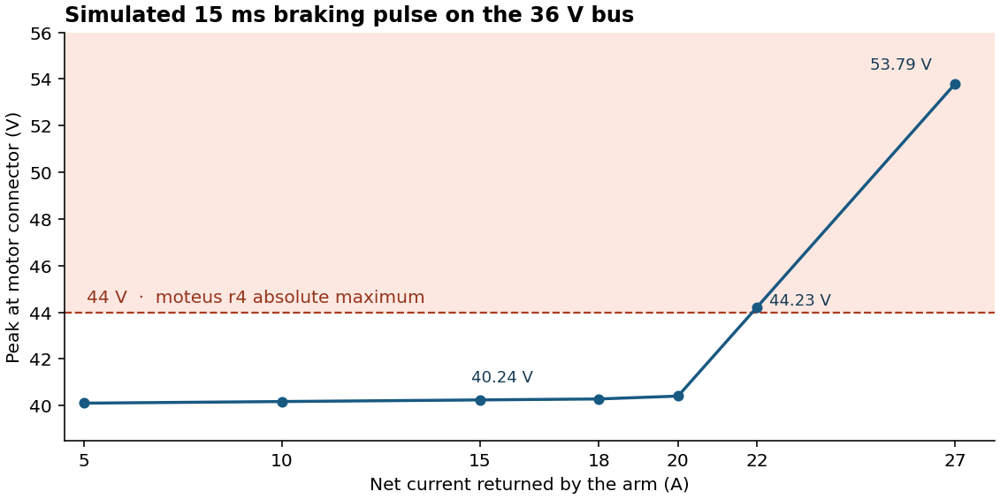

# Rev F manufacturing review for the impedance-controlled arm

**Release decision, November 17, 2026.** The fabrication data pass for a first article. Hold release for powered robot use. A 36 V supply, a 2 Ω brake resistor and a shared moteus r4 gripper bus fail a plausible multi-axis braking case in simulation. The arm's payload, maximum negative bus current, descent energy, repetition rate and harness impedance have yet to be measured. The least expensive order evaluated keeps all 82 machine placements (including the six TO-263 MOSFETs) machine-placed and finishes one board by hand.

## What limits the arm

A backdriven joint can send energy to the shared DC bus when it produces torque against its motion. Other joints drawing power can absorb some of it. The chopper must absorb the **net** returned power. Motor phase-current limits and the PSU's 27 A output limit do not bound that quantity. A fast stop stresses peak absorption. A slow loaded descent or repeated damping cycles can stress average dissipation even if each voltage peak looks acceptable.

The post-layout ngspice model uses the existing 36 V source, 2 Ω resistor, 1 µH brake wiring, 600 µF assumed motor capacitance, 1,880 µF onboard output capacitance and nominal +4 V brake setting. Current rises over 0.1 ms, holds from 1.1 to 16 ms, then falls over 0.1 ms. The voltage below is measured in the model at the far end of the motor harness. The model lumps multiple drives into one current source and one harness. Simultaneous joints, cable branches, tolerances and actual drive controls can move these results.



| Returned current | Peak motor-end voltage | Peak brake branch current | Output capacitor bank RMS during 8–16 ms |
|---:|---:|---:|---:|
| 5 A | 40.10 V | 19.79 A | 6.39 A |
| 10 A | 40.17 V | 19.80 A | 7.27 A |
| 15 A | 40.24 V | 19.82 A | 5.91 A |
| 18 A | 40.28 V | 19.84 A | 3.70 A |
| 20 A | 40.41 V | 19.99 A | 0.02 A |
| 22 A | **44.23 V** | 21.88 A | 0.24 A |
| 27 A | **53.79 V** | **26.61 A** | 0.79 A |

The sharp change around 20 A follows directly from Ohm's law. At 40 V a fully enabled 2 Ω branch takes 20 A. Beyond that point the bus rises until the branch takes the extra current or the event ends. At 27 A the resistive equilibrium is about 54 V. Lowering the trigger gives a little more time at the start of the pulse. It cannot increase the current the resistor absorbs at 44 V. Unitree lists 24–75 V for the N6014B-12.6, while mjbots specifies 44 V absolute maximum for the r4. The gripper sets the shared-bus ceiling, and a 48 V supply already exceeds it. [Unitree electrical specifications](https://www.unitree.com/IM6014/) · [moteus electrical limits](https://mjbots.github.io/moteus/reference/hardware/)

**External-resistor sensitivity.** At 22 A returned, the same model reached 46.25 V with a 2.10 Ω resistor, the high end of a 2 Ω ±5% part. A nominal 1.8 Ω candidate reached 40.34 V at 22 A, or 41.96 V with its resistance raised to 1.89 Ω. At 27 A the nominal 1.8 Ω candidate still reached 48.82 V and 26.80 A in the brake branch, above the 25 A thermal-fuse rating. These comparisons change only the resistor. Before choosing a lower resistance, check its cold tolerance, hot resistance, inductance, pulse-energy curve, cooling, switch and fuse ratings, and measured peak current. If 27 A regenerative pulses are required, dimension the complete brake branch for that envelope or give the gripper a separately protected supply. The factory files retain the reviewed 2 Ω configuration. A later check (README, *Two brake resistors in parallel*) simulated two 2 Ω resistors in parallel, each with its own thermal fuse: the bus stays at 40.2–40.5 V up to 35 A returned, at the cost of about twice the capacitor ripple and 24–37 A RMS through J5 while braking.

**Average power and capacitance.** At 40 V the 2 Ω resistor dissipates 800 W while on. Even a correctly heatsunk 200 W resistor has an ideal long-term ceiling around 25% on-time, equivalent to about 5 A average returned at that voltage. Real cooling can lower it. A 15 A, 40 ms event at 40 V returns about 24 J. Repeating it once a second gives 24 W, repeating it ten times a second gives 240 W. Verify the pulse rating separately from average watts. At 10 A returned, the model also predicts 1.82 A RMS per capacitor if all four share equally. The design records cite 1.69 A per can at 100 kHz, whereas the chopper operates around 1 kHz (roughly 1.3 A after typical low-ESR electrolytic frequency derating). Check the frequency correction and capacitor case temperature for the actual duty. Removing bulk capacitors would reduce stored energy margin and increase ripple per remaining can.

**Open brake or tripped thermal switch.** J11 opening disables the chopper. A blown series thermal fuse physically opens the brake branch. At 15 A, 1,880 µF buys about **0.50 ms** for the output to rise from 40 to 44 V after loss of the brake. Adding the model's 600 µF gives 0.66 ms. An application-level stop cannot be credited with catching this event. Qualify the loss-of-brake response with a protected surrogate load. A sustained backdrive fault may require independent energy absorption or isolation of the vulnerable load.

## Power path, protection and connectors

- **Input connection.** C17 is a 470 µF capacitor directly across J1, upstream of the output soft start. Charging it to 36 V stores 0.305 J. In the existing ideal-source model the newly instrumented J1 current peaks at 275 A for the 36 V connection, at about 21 µs. The peak through the soft-start MOSFETs during output enable is only 0.341 A with the nominal model load. Real connector bounce, PSU output capacitance, current limiting, ESR and cable impedance dominate J1's actual peak. SW1 cannot precharge C17. Mate the supply lead de-energized for the prototype and measure the power-up waveform. A live-mating requirement needs its own input precharge or qualified anti-spark interface.
- **Voltage spikes.** D1/D2 are SMCJ51A devices with 51 V stand-off, minimum 56.7 V breakdown and 82.4 V specified clamp at 18.2 A. TI rates several positive U1 bus pins at 65 V operating and 70 V absolute maximum. The 82.4 V figure is one pulse test point. A real spike can be lower or higher depending on current, waveform and layout. The specified TVS cannot guarantee U1's limit at that test point and cannot protect a 44 V gripper against a failed brake. Qualify U1 pin voltage with short-loop probing and provide a separately defined surge envelope before claiming protection. [TVS part record](https://www.lcsc.com/product-detail/C42371549.html) · [TI LM7480-Q1 data sheet](https://www.ti.com/lit/ds/symlink/lm7480-q1.pdf)
- **Conduction and thermal margin.** The existing 1 oz copper model gives 3.13 mΩ through the board, 2.28 W in copper and 4.90 W in the forward MOSFETs at 27 A. The hottest tab rises 66 °C above ambient. At 35 °C ambient that means about 101 °C at the tab, with junction temperature still to be established. The corresponding 2 oz model gives about 46 °C rise. Average forward current alone is insufficient for sizing because conduction losses scale with mean squared current. Measure actual RMS current and reach thermal equilibrium with the intended enclosure, airflow, connectors and hand-solder joints.
- **Pad mapping.** The board connects J1 pin 2 to VIN and pin 1 to GND. Each XT30 output has pin 2 on VOUT and pin 1 on GND. J5 pin 2 is VOUT and pin 1 is the switched brake drain. U1's exposed pad is electrically floating as TI specifies. U4's five DBV pads map in order to VREG, GND, CMP_OUT, GND and VG, consistent with a non-inverting gate driver. Verify the actual mating harnesses at their far ends before power. [TI UCC27517 data sheet](https://www.ti.com/lit/ds/symlink/ucc27517.pdf)
- **Connector fit.** The J1 Amass drawing gives 2.90–3.00 mm contact holes and 0.80–0.90 mm × 1.90–2.00 mm plated locating slots. JLC publishes +0.13/−0.08 mm PTH and plated-slot tolerance. Setting nominal contact drills to 3.00 mm and locating slots to 0.90 × 2.00 mm (in 1.50 × 2.60 mm pads) keeps the −0.08 mm minimum at 2.92 mm and 0.82 × 1.92 mm, preventing undersize interference while allowing up to +0.13 mm extra clearance at the upper end. Confirm finished dimensions on the first article with the ordered J1 and J5 parts. J5's female drawing lacks equivalent PCB-hole dimensions. A 1:1 paper print checks pitch but cannot check plating, slot-end radius or seating. [Amass J1 part and drawing](https://www.lcsc.com/product-detail/C98732.html) · [JLC fabrication capabilities](https://jlcpcb.com/capabilities/Capab)

## Cheapest prototype order evaluated

Five 1 oz bare boards, two JLC Economic top-side assemblies (82 placements on 45 BOM lines), hand parts for one board (19 board positions before omitting unused connectors). Fit the four used motor/gripper outputs. Leave spare output J7 and optional monitor header J12 empty if unused. Fit J11 and the brake protection. Buy one series thermal fuse and one spare. This saves **$5.53** versus buying two full hand kits in the same order with catalog purchasing minimums. The remaining partly assembled board can be finished later if the first article passes.

| USD per order | Basis |
|---:|---|
| $10.10 | Prior quote for five 125 × 100 mm PCBs, 1.6 mm FR-4, 1 oz, HASL |
| $10.79 | Setup $8.18, stencil $1.53, placement review $0.45 and 394 joints at $0.0016 |
| $18.42 | Six expected Extended feeders at $3.07 each (U1, U4, C410926 MOSFETs, D11 and both 0.1 % values) |
| $15.69 / $21.96 | Machine parts at placement quantities / with catalog minimums and loss allowance |
| $10.38 | One hand-parts purchase including buying minimums, with J7 and J12 omitted |
| **$65.38 / $71.65** | **Prototype PCB and onboard components, plus the thermal fuse and spare, before freight and tax** |

Dollar totals use unrounded unit prices. Fabrication uses the project's November 11 quote and component prices use November 17 JLC catalog snapshots. JLC publishes the assembly rates and describes the five-PCB/two-assembly combination. All 45 catalog records, including U1 and C410926, had xrayFlag false in the snapshot. JLC also describes X-ray inspection for hidden-joint packages. If the quote assigns U1 that inspection, two units at $1.64 add $3.28, bringing the allowance scenario to $74.93. The three historically Preferred codes (C42371549, C19077413, C41375109) appear as Extended in the public part-detail endpoint. If checkout charges all three, allow another $9.21. Both contingencies together bring the allowance scenario to $84.14. Confirm panel/tooling charges, freight and tax in checkout. External power resistor, heat sink, input fuse/holder, normally closed thermal switch, cables, mating connectors and mounting hardware are additional. For scale, Mouser listed one TE HSC2002R0J, 2 Ω / 200 W, at $49.63. That example alone brings the estimate to **$115.01–$121.28** before the other external items. Inventory already owned changes the comparison. [JLC assembly charges](https://jlcpcb.com/help/article/pcb-assembly-price) · [JLC assembly terms](https://jlcpcb.com/help/article/terms-and-conditions-of-jlcpcb-assembly-service) · [TE resistor](https://www.te.com/en/product-1-1630019-5.html) · [Mouser single-unit listing](https://www.mouser.com/en/c/passive-components/resistors/wirewound-resistors/wirewound-resistors-chassis-mount/?power+rating=200+W&resistance=2+Ohms)

- **PCBWay.** At the advertised $29 assembly price, PCBWay must supply fabrication, machine parts and other vendor charges for less than **$26.00** to beat the JLC placement-quantity estimate or **$32.27** to beat the allowance estimate, assuming equal freight and the same hand kit. A one-assembly PCBWay quote is worth comparing as only one working prototype is needed. Eligibility and sourcing charges require a vendor quote. [PCBWay assembly offer](https://www.pcbway.com/blog/PCB_Design_Layout/How_to_Get_29_PCB_Assembly_and_Meet_the_Requirements_e334dbde.html)
- **Precision resistors.** Replacing both 0.1% divider values with Basic 1% parts could save about $6.14 per order. Evaluating all 128 resistor-endpoint combinations using the schematic's trip-divider equations at fixed VIN = 36 V, measured TP9 = 6.2 V and gate low gives 39.87–40.20 V with the fitted values and 38.78–41.34 V with all seven resistors at 1%. These bounds omit comparator offset, trimmer error, noise and temperature. Keep the four precision placements for this shared-bus prototype.
- **Copper and outline.** The historical quote rose $37.30 for five boards in 2 oz. Extra copper helps forward-path heating. It does little for a brake branch that has already reached full duty. Shrinking to JLC's 100 × 100 mm promotional envelope would require changing the 115 mm mounting pitch and revalidating the connector placement and high-current copper. [JLC prototype size tier](https://jlcpcb.com/help/article/how-do-i-place-an-order)
- **Buy versus build.** ODrive lists its assembled regeneration clamp at $89 with a 2 Ω, 50 W resistor. A separate soft start, distribution harness and any higher-duty resistor would have to be costed to compare equivalent systems. A custom board has no demonstrated all-in cost advantage for a single arm until the external parts and delivered prices are known. [ODrive product and pricing](https://shop.odriverobotics.com/products/odrive-regeneration-clamp)

## Fabrication evidence and release gates

KiCad CLI 10.0.8 passed all-severity ERC and DRC, schematic parity and zone refill. The rule-canary check passed. An independent comparison of the schematic XML against the copper pads exported in IPC-2581 matched **261 connected reference/pin pairs**, with no missing or additional connected pins. The final Konnect MCP six-audit review reported zero findings at info severity. Its manufacturing checks reported two copper layers, 133 footprints and zero DFM findings. These checks operate on saved design files. Use the saved KiCad project and the release exporter below to reproduce this review. The additional tools/check_all.sh checks require KiCad Python bindings.

Rev F suppresses front-paste openings on the hand-soldered SMD/hybrid footprints (`C1`, `C2`, `C6` and `SW1`) using native KiCad per-footprint paste settings while keeping all **197** machine-pad flashes (including the six TO-263 MOSFETs, `Q1`, `Q2`, `Q3`, `Q7`, `Q8`, `Q9`) on `F.Paste` and exporting `B.Paste` in the 11-file Gerber archive. The PCB and schematic reference the same bundled fiducial footprint to avoid standard-library drift. The export stops if the pasted references differ from the 82-row placement file. Because `F.Paste` emits full-pad openings on the six TO-263 tabs and one 82 %-area rectangle on `U1`'s floating thermal pad, allow JLCPCB's SMT engineers to apply their standard IPC-7525 window-pane stencil segmentation to the six TO-263 drain tabs and `U1` thermal pad while noting in the order comments that `SW1` and `C1`/`C2`/`C6` intentionally omit paste openings. [JLC stencil and inspection policy](https://jlcpcb.com/help/article/pcb-assembly-price)

1. **Before assembly release**, verify finished J1/J5 holes against the actual connectors on the first article or obtain the fabricator's dimensional acceptance. Check U1 pin 1, the six TO-263 orientations, the LED cathodes and the 82-part top-side machine population in the vendor preview, and reject any `50 V`-rated `0603` substitutes for `R1`, `R3`, `R10`, `R14` or `R44` (`75 V` rated in BOM). The gripper should stay disconnected for the initial electrical tests.
2. **Before connecting the arm**, verify J1, all used outputs and mating cable polarity (at a 0.5 A bench current limit first, since a 27 A CC supply will not blow a 30 A fuse if D1 conducts in reverse), series fuse, resistor mounting and cold resistance. Inspect the six factory-reflowed TO-263 tab joints and the hand-soldered 1206 MLCCs (`C1`, `C2`, `C6`, soldered with hot air or a hot plate). Use a protected surrogate load to measure VIN at U1, VOUT at the board, VREG on `TP5` (including AC-coupled `>= 20 MHz` check for `CJ431` stability), voltage at the far gripper connector, each gate relative to its source (keeping `TP9 <= 7.7 V` at 48 V for `LM393` common-mode margin), returned bus current and brake current. Capture normal operation, enable, supply removal and the loss-of-brake condition with bounded energy. Establish a working voltage ceiling below 44 V that includes component tolerance, harness variation, measurement uncertainty and fault response. A reading of 43.99 V at one operating point is insufficient.
3. **Before enabling fast or backdriven operation**, establish the worst payload, simultaneous joint speed/torque and descent distance. Bound event energy from lost kinetic and gravitational energy, or integrate measured returned power. Compare peak net current, per-event joules and long-term average watts with the qualified branch and actual resistor pulse curve. Include externally forced backdrive in the operating envelope.
4. **Before increasing quantity**, repeat the worst allowed duty at maximum ambient through thermal equilibrium. Record the six MOSFET tabs, all four output cans, connectors, resistor case and heat sink temperatures. Confirm the resistor switch/fuse coordination and independent response to loss of energy absorption. If any electrical or thermal gate fails, revise the branch or impose an enforceable operating limit before releasing the design.

Reproduce the saved design and simulation checks from the project root with KiCad on PATH and ngspice 47 available.

```sh
python3 tools/gate.py . regen_precharge tools/gate_waivers.json
bash tools/make_jlc.sh /tmp/regen-prototype-fab
ngspice -b sim_post_layout.cir
ngspice -b sim_soft_start.cir
ngspice -b sim_regen_clamp.cir
ngspice -b sim_brake_latch_48v.cir
```
